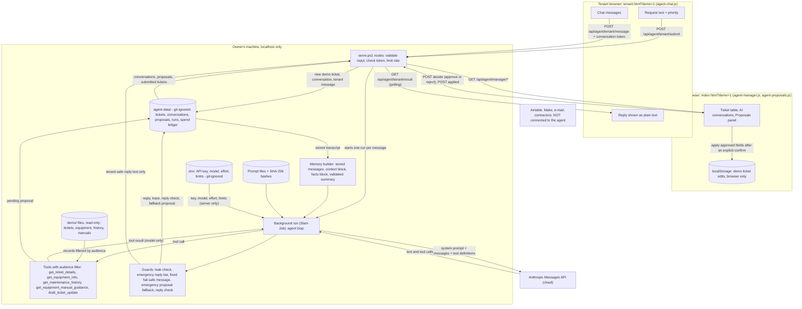
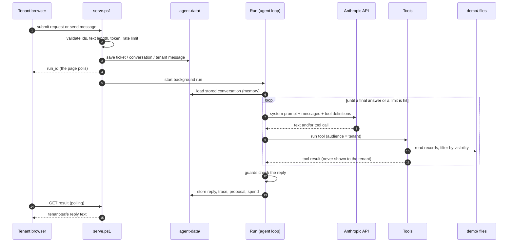
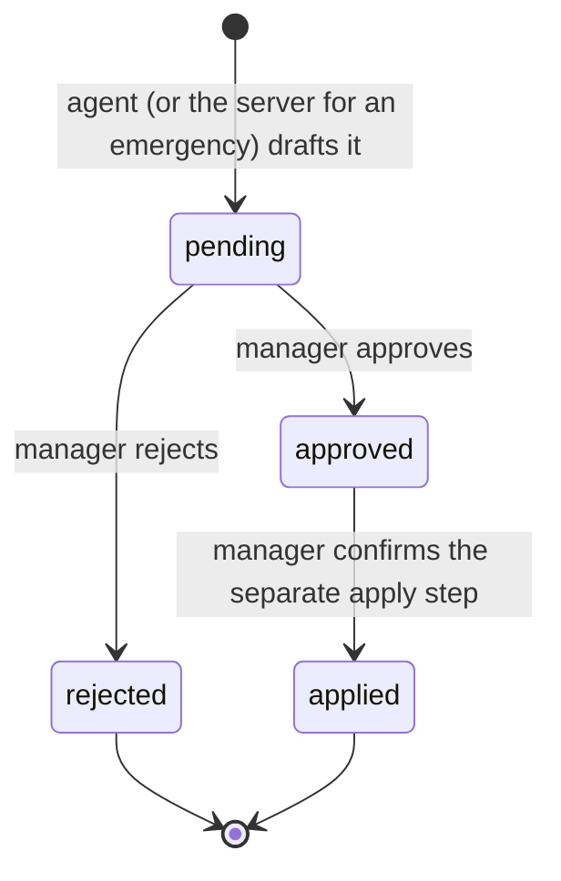
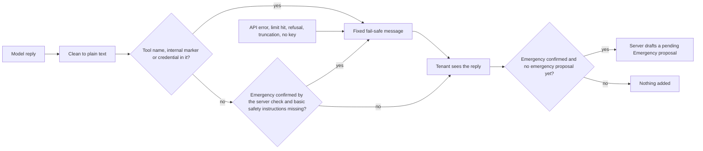
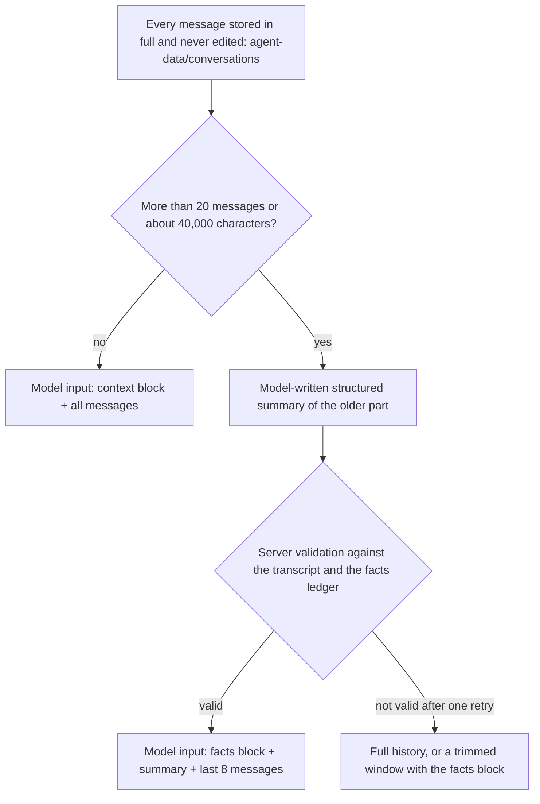
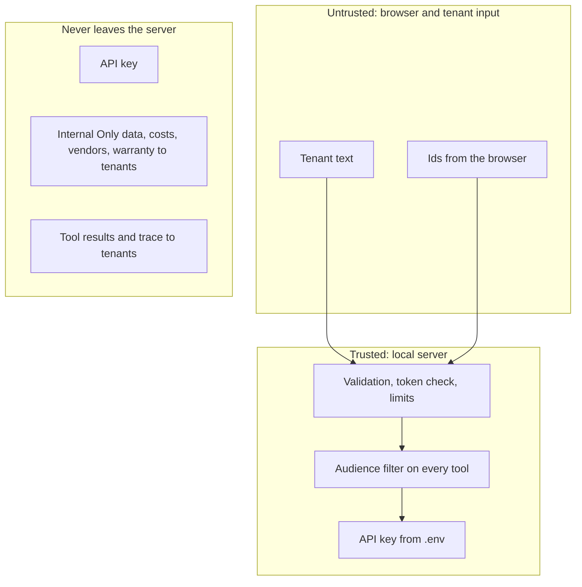

# Architecture: Tenant Maintenance Dashboard and AI Maintenance Assistant

**Task 4 (Architecture).** This document explains, for the AI Maintenance Assistant that was built on Claude (Anthropic Messages API): **what triggers it** (section 3), **what happens to its output** (section 4), and **where every piece of data comes from and goes** (the information-flow diagram in section 2, with the detailed flows in sections 5 to 8). Repository: <https://github.com/stavdayan-netizen/Dashboard-Practice>. The agent design (tools, memory, prompt, model settings) is in [`SPEC.md`](SPEC.md); this file shows how the pieces connect.

**What is real and what is not.** The agent works end to end, but only as a **local demo**: it runs on one machine behind `localhost`, on fictional data for the property "10 Harbor View", with no sign-in, no cloud backend and no connection to Airtable, Make or e-mail. It was built on the Anthropic Messages API with tool use, called from PowerShell. It is **not** an Anthropic Platform hosted agent and **not** a Make scenario. Real-world use would need real authentication and authorization first (section 9).

## 1. Components

| Component | What it is | Where it runs | Role for the agent |
| --- | --- | --- | --- |
| Dashboard (`index.html`, `app.js`, `styles.css`) | Property manager view: KPIs, charts, tickets, Vendor Research | Browser; GitHub Pages or `localhost` | Unchanged for real data. With `?demo=1` on the local server it also shows the AI conversations, the proposals panel and tickets submitted through the demo portal |
| Demo mode (`?demo=1`, `systems.js`, `tickets-demo.js`, `receipt-store.js`) | Fictional 10 Harbor View data, equipment, ticket details | Browser; edits in localStorage / IndexedDB | The manager's applied proposals are saved here (browser only) |
| Tenant portal (`tenant.html`, `tenant.js`, `agent-chat.js`) | Tenant request form | Browser | Normal mode: creates a ticket through Make (unchanged). **Demo mode on the local server:** the submit is intercepted, the request becomes a local demo ticket (never sent to Make) and the form is replaced by the chat |
| `serve.ps1` + `agent/agent-api.ps1` | Local PowerShell server: static files, Vendor Research API, `/api/agent/*` routes | The owner's machine, `localhost` only | Receives the trigger, validates, starts the run, serves replies and manager data |
| Agent code (`agent/agent-lib.ps1`, `agent-config.ps1`, `agent-loop.ps1`, `agent-runs.ps1`) | Tools, store, memory, model loop, guards, background runs | PowerShell process started by `serve.ps1` (`Start-Job`) | The agent itself |
| `demo/` data pack | Tickets, ticket details, equipment, history, utilities, shutoffs, `manuals.json` (verified manufacturer guidance) | Static files, read only | The agent's only source of facts |
| Prompt files (`agent/system-prompt.draft.md`, `system-prompt.connected-addendum.md`, `prompt-hashes.json`) | Base prompt (verbatim, tested in the Anthropic Playground) + connected-mode addendum, hash-guarded | Repo files read by the run | The agent's instructions |
| `.env` | `ANTHROPIC_API_KEY`, model, effort, limits | Git-ignored, the owner's machine | Read by the server only |
| `agent-data/` | Demo tickets, conversations, proposals, run files, spend ledger as JSON | Git-ignored, the owner's machine | The agent's memory and outputs |
| Anthropic Messages API | The model, with tool use | Anthropic cloud | Called by the run with the prompt, the messages and the tool definitions |
| Airtable, Make | Real ticket data and the real portal pipeline | Cloud | **Not connected to the agent** |

## 2. Information-flow diagram (where data comes from and where it goes)

Reading the diagram:

- **Data in:** the tenant's text and priority; the fictional `demo/` records; the two prompt files; the settings and key in `.env`; the stored conversation (memory).
- **Data out:** the plain-text reply to the tenant; stored conversations, traces and pending proposals for the manager; a spend ledger. After the manager approves **and** separately confirms, the changes are written to the demo ticket in the manager's browser.
- **Never leaves the server:** the API key, tool results, the tool trace, costs, the prompt, and Internal Only data (the browser only receives what its route allows).
- **Not connected:** nothing is written to Airtable, nothing is sent to Make, no e-mail or notification is sent, no contractor is contacted.

## 3. Trigger: what starts the agent

The agent is started **only by a tenant action in the demo portal**, never by a timer, Make, Airtable or the manager.

| Trigger | Route | What happens |
| --- | --- | --- |
| The tenant submits the request form (demo mode, local server) | `POST /api/agent/tenant/submit` | The server saves a new demo ticket (`HV-101` and up) in `agent-data/tickets`, opens a conversation for it, stores the request text as the first tenant message and starts the first run, so **the assistant opens the conversation by itself** |
| The tenant sends a chat message | `POST /api/agent/tenant/message` (header `X-Conversation-Token`) | One run per message; refused with 409 while a reply is already being prepared |
| The tenant page retries after a failure | `POST /api/agent/tenant/resume` | Answers the saved tenant message that has no reply yet; adds no new message |

A run is a separate PowerShell process (`Start-Job`) because `serve.ps1` handles one request at a time; the browser polls `GET /api/agent/tenant/result`. Live calls need both the key and `AGENT_LIVE_ENABLED=1` in `.env`; if the assistant is switched off, the ticket and conversation are still saved and the tenant is told that no automatic reply will come.

## 4. Output: what happens to what the agent produces

| Output | Goes to | Who can see it |
| --- | --- | --- |
| Reply text (plain text, cleaned by the guards) | The tenant's chat, and the stored conversation | Tenant, manager |
| A fixed fail-safe message (model failed, a limit was hit, or a guard replaced the reply) | Same | Tenant, manager (the manager also sees why) |
| **Pending proposal** from `draft_ticket_update` (classification Routine, Urgent or Emergency, summary, notes, status, linked equipment; never the priority) | `agent-data/proposals/` | Manager only: Proposals panel, count badge and, for an emergency, a banner |
| A **server-drafted emergency proposal** (fixed template plus the tenant's own words) when the existing emergency check confirms an emergency and no emergency proposal exists | Same; labelled as drafted by the server | Manager only |
| Tool trace, reply check, guard and fail-safe events | The stored conversation | Manager only (conversation view) |
| Spend ledger (estimated cost per call) | `agent-data/spend.json` | The owner; the status route shows totals, never the key |
| An applied proposal | The demo ticket **in the manager's browser** (localStorage), after the manager approved it and then confirmed a separate apply step; the server only records "applied" | Manager's browser only |

Nothing else happens: no write to a real ticket, Airtable or Make, no e-mail or SMS, no contractor dispatch, no booking. A proposal changes nothing until a manager acts, and replies to the tenant are never held for review.

## 5. Guards between the model and the tenant

- A run is bounded by tool rounds, output and input tokens, wall-clock time, a per-call timeout, retries and spend (per run, per day and in total; the worst case of a call must fit before it is sent).
- Tool results, summaries, the trace, costs and credentials never leave the server; the tenant routes return only status and reply.
- After each turn the server records a **reply check** on the proposals of that turn: which basic safety instructions the final reply really contained versus what the proposal text claims.

## 6. Memory (how the agent remembers)

The API is stateless, so the server rebuilds the model input from the stored conversation on every turn. A short **context block** (the ticket id and the tenant-visible equipment linked to it, plus a note when the ticket was just submitted) is added to the input only and is not stored in the transcript. For a long conversation the older part is replaced by a model-written summary that the server **validates** against a deterministic **facts ledger** (safety reports, refusals, checks attempted, whether the introduction was given); the summary is reused until about 16 more messages accumulate. The agent has **no memory across conversations**: each conversation is bound to one ticket, and the only cross-ticket knowledge comes from the maintenance-history tool. Details and limits: `SPEC.md`.

## 7. Data sources and trust

| Data | Source for the agent | Notes |
| --- | --- | --- |
| Tickets and details | `demo/tickets.csv`, `demo/ticket_details.json`, plus tickets submitted through the demo portal in `agent-data/tickets` | The server cannot see edits that exist only in a browser |
| Equipment and history | `demo/equipment.json`, `demo/equipment_history.json`, linked tickets | History is built from tickets |
| Manufacturer guidance | `demo/manuals.json` | Official links, exact models, page references, short summaries written for this project; all four are series-level guidance. No manufacturer PDF is stored |
| Utilities and shutoffs | `demo/utilities.json`, `demo/shutoffs.json` | Used only as `agent/EMERGENCY_RULES.md` allows; no utility tool exists, so the assistant names no gas company |
| Conversations, proposals, spend | `agent-data/` | Local, Git-ignored |

Browser input is **not trusted**: the server accepts only ids and message text, checks each id against the data and the conversation's scope, and rejects anything unknown. Tenant text is data and cannot change tools, the audience or the rules.

## 8. Security boundaries and honest limits

- The API key lives only in the Git-ignored `.env`; it is never in browser code, the repo, logs, conversations or documentation, and it is sent only to `https://api.anthropic.com/v1/messages`.
- **localhost only, no sign-in.** Tenant and manager are separated only by route on `localhost` (and a one-time token per conversation for tenant routes). The manager routes are **not** a security boundary: anyone who can reach the local server can call them. The server refuses non-local requests and unexpected `Host` headers. **Real authentication, per-user roles, ticket-ownership checks and protected manager routes are required before any real-world deployment.**
- The chat and manager features are loaded only with `?demo=1` on `localhost`; on GitHub Pages they are absent and the existing pages behave as before. The agent is not deployed publicly.
- Data is plain files on one machine: no backup and no multi-user use. An applied proposal exists only in the manager's browser.
- Emergency detection and the reply check are keyword based and cover the basic cases; model wording varies between runs, so what is guaranteed is the server-side checks.

## 9. Model configuration (actual)

- API: Anthropic Messages API with tool use, called with `Invoke-WebRequest` to the fixed address `https://api.anthropic.com/v1/messages` (header `anthropic-version: 2023-06-01`; PowerShell has no official SDK), inside the background run.
- Model: `claude-haiku-5-5` by default (`AGENT_MODEL=haiku`); `claude-sonnet-5-5` is selectable (`sonnet`) but has not been run live. **Effort: `medium`** (`AGENT_EFFORT`, sent as `output_config.effort`). No sampling parameters, prefill or forced tool choice; thinking is left to the model default.
- Limits (defaults): 6 tool rounds per run, 4096 output tokens per call, about 60,000 estimated input tokens per call, 90 s per run, 60 s per call, 2 retries (only for 429, 5xx and timeouts), spend $0.25 per run, $1 per day and $5 in total, tenant message at most 2000 characters, at most 200 messages per conversation. Typed `.env` values can lower the limits but never raise them past hard ceilings.
- Prompt: the verbatim base prompt (`agent/system-prompt.draft.md`) plus the connected-mode addendum at revision 6 (`agent/system-prompt.connected-addendum.md`), joined at run time and checked against `agent/prompt-hashes.json`; the agent refuses to start if either text changed without the owner running `Update-PromptHashes.ps1 -Confirm`. The hashes are stored with each conversation.

## 10. Tests and status

All free (a scripted mock model, no key, no network): five PowerShell suites with 784 checks (`agent/tests/`), plus mocked end-to-end scenarios with recorded transcripts (`agent/scenarios/`). Live runs on Haiku 5.5 so far: dishwasher, fridge, dishwasher through the portal and dashboard, gas, and a carbon monoxide alarm, for about $0.03 in total. Status per stage and the remaining live-test plan: `agent/STAGE6_PLAN.md`, `agent/AGENT_SPEC.md` (sections 11 to 13) and `agent/FINAL_LIVE_TEST_PLAN.md`.
