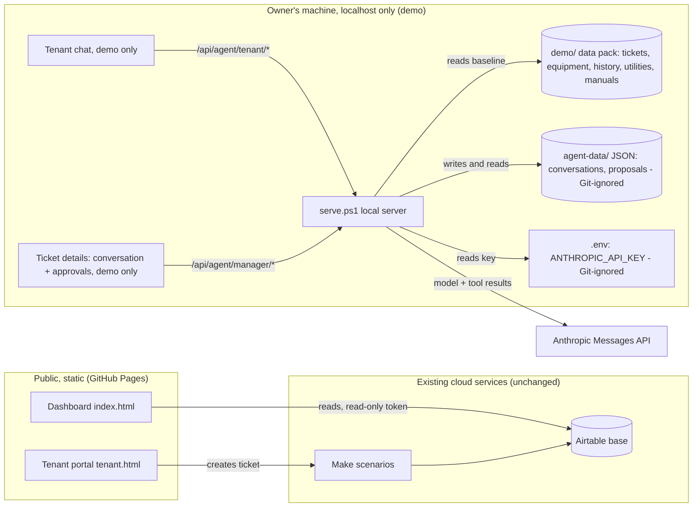
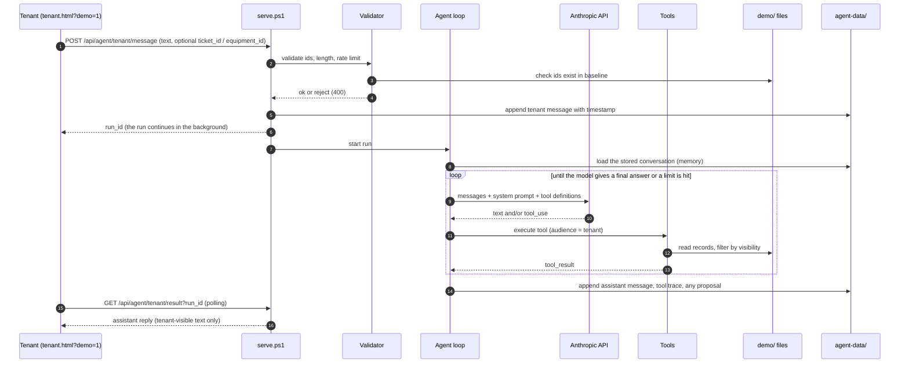
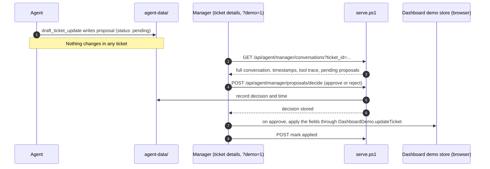
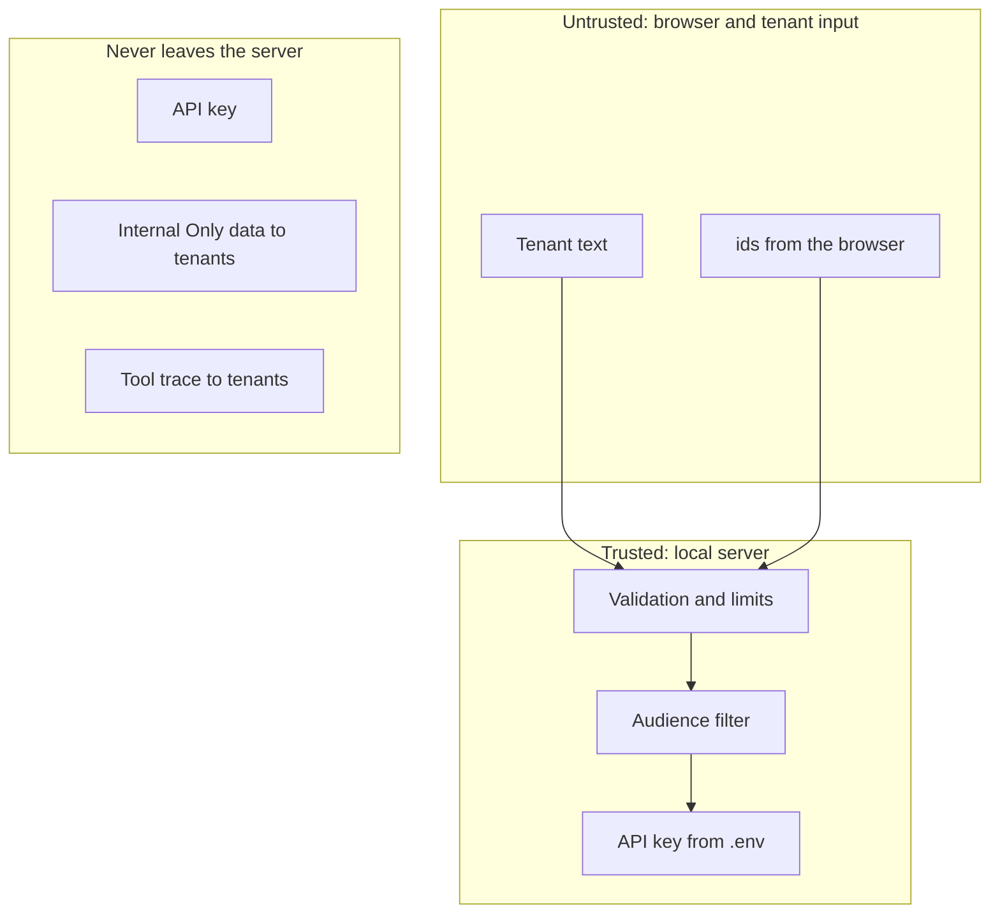

# Architecture: Tenant Maintenance Dashboard and AI Maintenance Assistant

**Status of this document:** describes the system as it exists today and the AI Maintenance Assistant as it is planned for the local demo (Task 3, the third stage of the assistant plan). Items marked **[planned]** are not built yet. The agent behavior (system prompt) is specified separately and is **pending** the tested prompt from the Anthropic Playground; this document does not define wording or decision rules. The behavioral spec is in `SPEC.MD` and `agent/`.

Nothing here adds a cloud backend, a public AI chat, or a production integration. The AI features run only on a local machine, in the isolated `?demo=1` environment, on fictional data for 10 Harbor View.

## 1. Components

| Component | What it is | Where it runs | Status |
| --- | --- | --- | --- |
| Dashboard (`index.html`, `app.js`, `styles.css`) | Property manager view: KPIs, charts, tickets, Vendor Research | Browser; hosted on GitHub Pages or `localhost` | Built |
| Demo mode (`?demo=1`, `systems.js`, `tickets-demo.js`, `receipt-store.js`) | Fictional 10 Harbor View data, Systems and Equipment, ticket details, receipts | Browser; edits in localStorage and IndexedDB | Built |
| Tenant portal (`tenant.html`, `tenant.js`) | Tenant request form; creates a ticket through Make | Browser | Built (live; unchanged) |
| Airtable | Real ticket and property data, read with a public read-only token | Cloud | Built (not touched by the agent) |
| Make scenarios | Portal request to Airtable ticket; email on new ticket | Cloud (inactive) | Built (not touched by the agent) |
| `serve.ps1` | Local PowerShell server: static files, Vendor Research API, **[planned]** agent API | The owner's machine, `localhost` only | Built; agent routes planned |
| Demo data pack (`demo/`) | Tickets, ticket details, equipment, history, utilities, shutoffs, **[planned]** manuals registry | Static files | Built; manuals planned |
| Agent store (`agent-data/`) | Conversations and proposals as JSON files | The owner's machine, Git-ignored | **[planned]** |
| Anthropic Messages API | The model, with tool use | Anthropic cloud | **[planned]**, key stays on the server |
| Demo tenant chat (inside `tenant.html?demo=1`) | The tenant's way to talk to the agent | Browser, local only | **[planned]** |
| Manager conversation and approvals (ticket details in `?demo=1`) | The manager reads the full conversation and approves or rejects proposals | Browser, local only | **[planned]** |

## 2. System architecture

Key points:

- The browser never talks to Anthropic and never sees the API key. It talks only to `/api/agent/*` on `localhost`.
- On GitHub Pages the agent routes do not exist. The chat and the approval controls are hidden or disabled with a notice, the same way Vendor Research behaves.
- The agent has **no connection** to Airtable, Make, or the real dashboard. Its only data source is `demo/`.

## 3. Data flow: a tenant talks to the agent

Design notes:

- The server runs the agent in the background and the browser **polls**, as Vendor Research does. `serve.ps1` handles one request at a time, so a long model call must not block it.
- **Audience comes from the route**, never from the request body. `/api/agent/tenant/*` always means tenant. Tools filter fields by that audience on the server (Internal Only data, costs, vendors and receipts are never returned to a tenant conversation).
- Every run has hard limits: maximum tool rounds, maximum output tokens, maximum message length, and a per-conversation message cap, to bound cost.

## 4. Data flow: proposal, manager approval, ticket

- A proposal is **only a record**. The agent has no tool that writes to a ticket.
- Approval is applied by the dashboard in the browser (demo tickets live in the browser), so approving does not touch Airtable or Make.
- A proposal can create a ticket. On approval the dashboard creates the demo ticket and the conversation is linked to the new ticket id, after which the conversation shows in that ticket's details.
- Emergency safety guidance is the one case that is not held for review (`agent/EMERGENCY_RULES.md`): the approved message is sent to the tenant at once, and the ticket change is still a proposal.

## 5. Data sources and trust

| Data | Source of truth for the agent | Notes |
| --- | --- | --- |
| Tickets and ticket details | `demo/tickets.csv`, `demo/ticket_details.json` | Baseline only |
| Equipment and history | `demo/equipment.json`, `demo/equipment_history.json`, linked tickets | History is built from tickets, as in the dashboard |
| Utilities and shutoffs | `demo/utilities.json`, `demo/shutoffs.json` | Contact and shutoff use follows `agent/EMERGENCY_RULES.md` |
| Manufacturer guidance **[planned]** | `demo/manuals.json` | Official links, exact models, page or section references, short summaries. No manufacturer PDFs are stored in Git |
| Conversations and proposals **[planned]** | `agent-data/` | Local, Git-ignored |

**Browser-supplied data is not trusted.** The demo's manager edits and tenant-created tickets live in browser storage, which the server cannot see. For the local demo the server therefore:

- uses the files in `demo/` as the baseline;
- accepts from the browser only identifiers (ticket id, equipment id) and the message text, and validates each identifier against the baseline (known id, correct property, equipment linked to that ticket where a link exists);
- rejects anything unknown instead of guessing.

**Known limits of this approach** (documented, accepted for the demo):

- The agent does not see changes made only in the browser, for example a status edited after the page loaded, or equipment added in the Systems view. Tickets created in the demo browser are unknown to the server until a proposal for them is approved and linked.
- There is no sign-in. Tenant and manager are separated only by route, on `localhost`. Anyone who can reach the local server can call both. This is a visual and functional demo of the permission model, not a security boundary. A production system must authenticate users and authorize every tool call on the server.
- `agent-data/` is plain files on one machine: no locking beyond the single-request server, no backup, no multi-user use.

## 6. Security boundaries

- The API key lives only in the Git-ignored `.env` and is read by `serve.ps1`. It is never in browser code, the repo, logs, conversations or documentation.
- Tenant text is **data**, not instructions: it cannot change tools, the audience, or the rules. Tool inputs are validated and unknown ids are rejected.
- The existing Airtable read-only token pattern, the Make scenarios, the live tenant portal behavior and the real dashboard are not modified.
- The tenant chat is added to `tenant.html` only behind `?demo=1` and a local-server check. Without `?demo=1` the page behaves exactly as today.

## 7. Agent tools (executable, demo data)

| Tool | Reads | Audience filtering | Writes |
| --- | --- | --- | --- |
| `get_ticket_details` | Ticket and details | Tenant: no cost, vendor or Internal Only notes | Nothing |
| `get_equipment_info` | Equipment record | Tenant: Tenant Accessible fields only | Nothing |
| `get_maintenance_history` | History built from linked tickets | Tenant: tenant-safe summaries only | Nothing |
| `get_equipment_manual_guidance` | `demo/manuals.json` for the matched equipment | Tenant-safe checks only to tenants; professional-only items stay out | Nothing |
| `draft_ticket_update` | Nothing | n/a | A **pending proposal** in `agent-data/` |

Input and output schemas are in `SPEC.MD`.

## 8. Model configuration [planned]

- API: Anthropic Messages API with tool use, called from `serve.ps1` with `Invoke-RestMethod`.
- Model: configurable in `.env`; the starting model is Claude Haiku 5.5 with switching to Claude Sonnet 5.5. The exact model identifiers and their availability on the account are to be confirmed against the API when the key is configured. No final production model is chosen.
- The system prompt is the verbatim tested Playground prompt stored in the repo (`agent/system-prompt.draft.md`, no secrets in it), plus a separate connected-mode addendum that is not written yet. The addendum is tested before use (`agent/AGENT_SPEC.md` section 8).
- **Conversation memory:** the API is stateless, so on each tenant message the server rebuilds the message list from the stored conversation in `agent-data/` before calling the model; this is what keeps the one-time introduction, earlier refusals and unconfirmed resolution consistent.
- Tenant replies are plain text (no Markdown) and the first chat is text only.

## 9. What stays out of scope

A cloud backend, deploying or enabling the AI chat on GitHub Pages, real authentication, writing to Airtable, triggering Make, real tenant data, emergency notifications, contractor dispatch or booking, and storing manufacturer PDFs in Git.

## 10. Build stages

1. Documentation: this file and `SPEC.MD` (behavior pending the Playground prompt).
2. Replace the draft prompt with the tested Playground prompt; reconcile it with `agent/EMERGENCY_RULES.md`.
3. Demo equipment refresh with real brands and exact models and the manuals registry, preserving equipment ids and relationships.
4. Server tools, validation and the JSON store, tested without any API call.
5. API key configuration by the owner, then the agent loop with polling and cost limits.
6. Tenant chat in `tenant.html?demo=1`; conversation, proposals and approvals in the ticket details.
7. Scenario tests (12 emergency, 12 functional), recorded transcripts without secrets, final documentation.
